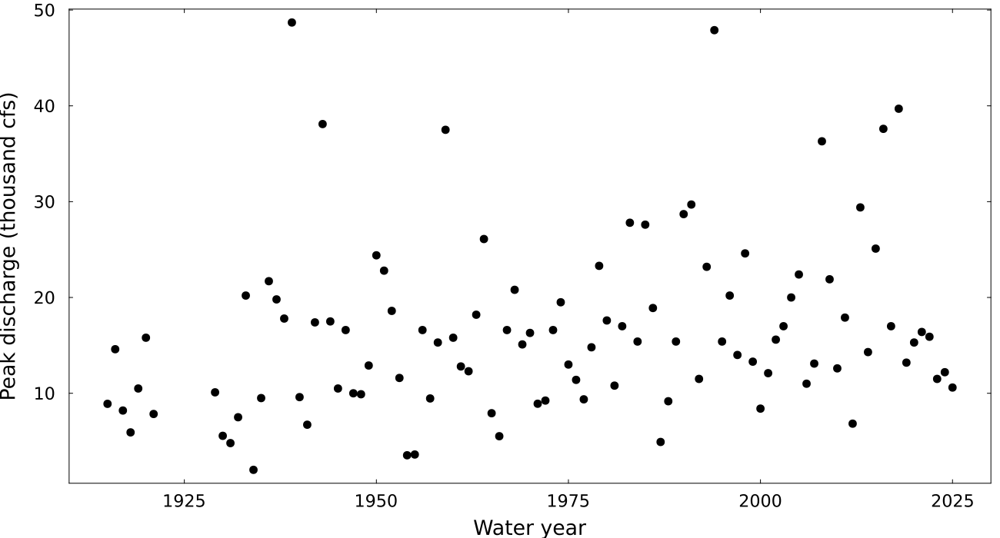

::: {.callout-important icon=false}
### Due: Thursday 25 March 2027, 9:00pm Eastern

Submit a PDF to Gradescope with **each sub-part tagged**. Untagged submissions lose 10%.

**20 points.** Five problems, one for each
session of the extreme-values unit, in the order of the sessions (19 to 23).
:::

The Vermilion River drains about 1,290 square miles of farmland and towns in east-central Illinois
above Danville, where the U.S. Geological Survey has measured it since 1914 (gauge 03339000). A county
is replacing a bridge near the gauge and asks for the **design discharge**: the flow the bridge's
opening must pass.

**Discharge** is the volume of water passing the gauge each second, in cubic feet per second (cfs;
1 cfs is about 0.028 m³/s). Work in **thousands of cfs**, so that every parameter is of order one.
USGS reports flows by **water year**, 1 October to 30 September, named for the year it ends. It
publishes two series: the **instantaneous annual peak**, the highest discharge at any moment in the
water year, and the **daily mean** discharge.

- `data/vermilion_peaks.csv` (`water_year,peak_cfs`): the instantaneous annual peaks of the 104 water
  years 1915–2025. There are none for 1922–1928, when the gauge was discontinued.
- `data/vermilion_daily.csv` (`date,discharge_cfs`): daily means, October 1914 to September 1921 and
  June 1928 to December 2025.

```julia
using CSV, DataFrames, Dates
peaks = CSV.read("data/vermilion_peaks.csv", DataFrame)
daily = CSV.read("data/vermilion_daily.csv", DataFrame)
daily.water_year = year.(daily.date) .+ (month.(daily.date) .>= 10)   # October starts the next water year
peaks.flow = peaks.peak_cfs ./ 1000      # thousand cfs
daily.flow = daily.discharge_cfs ./ 1000
```

::: {.callout-tip}
## Keeping a likelihood finite

Every model fitted numerically runs into the limits of floating-point numbers, not just this one.
Once a 0, an `Inf` or a `NaN` gets into a likelihood, an optimizer can't compare it with anything,
and a simulation that refits hundreds of datasets will find the cases your first fit didn't. Guard
every likelihood you write in this homework the way this one is guarded:

```julia
function gev_negative_log_likelihood(parameters, data)
    location, log_scale, shape = parameters
    scale = exp(log_scale)
    0 < scale < Inf || return Inf      # exp under- or overflowed
    gev = GeneralizedExtremeValue(location, scale, shape)
    total = try
        -sum(logpdf.(gev, data))
    catch error
        error isa DomainError || rethrow()   # a point on the support's edge; let other errors through
        Inf
    end
    return isfinite(total) ? total : Inf   # never return NaN
end
```

1. **Add log densities; never multiply densities.** A product of a hundred small densities is 0 in
   floating point; the sum of their logs is an ordinary number.
2. **Fit a positive parameter through its log, and check what `exp` gives back.** A scale of 0 or
   `Inf` makes `GeneralizedExtremeValue` throw an error rather than return a density.
3. **Return `Inf`, never `NaN` or an error, for an impossible parameter set.** A peak outside the
   GEV's support has zero density; `logpdf` usually returns `-Inf` there, but within rounding of the
   support's edge it can throw a `DomainError`. Catch that error and only that one.
4. **Put the data and predictors on a sensible scale, and start near the answer.** Thousands of cfs,
   and time in decades from 1970, keep every parameter of order one. Start from the Gumbel fit given
   by the mean and standard deviation.

If a fit still fails, don't drop it quietly: report how many failed and why.
:::

## Problem 1 — The record and the theorem's conditions (3 points)

{#fig-peaks width="100%" fig-pos="H"}

The extremal types theorem describes the maxima of blocks that come from one distribution and are
independent of each other. Check both conditions for the Vermilion's water years 1929–2025.

**(a) (1 point)** Fit a least-squares line to the natural log of the annual peaks against water year
(the log keeps the few largest floods from setting the slope), and give its slope $b$ as a change of
$100(e^{10b} - 1)$ percent per decade. Then shuffle the log peaks across years 1,000 times (call
`Random.seed!(1929)` once, before the loop), refitting the slope each time, and report the share of
shuffled slopes at least as large as yours. Does every water year's peak come from the same
distribution?

**(b) (1 point)** From the daily means, find the largest daily mean of each month from October 1928
to September 2025, and the median of these monthly maxima for each calendar month. Could one GEV
describe the maxima of every month, and what does that say about using months as blocks instead of
years?

**(c) (1 point)** For each water year and each calendar year 1929–2025, find the date of its largest
daily mean. For each kind of year, count the consecutive years whose two dates are 7 days apart or
less. Which kind of year would you use as the blocks, and why?

## Problem 2 — A GEV and a design discharge (5 points)

Use the peaks of water years 1929–2025, in thousand cfs.

**(a) (1 point)** Fit a GEV by maximum likelihood with a guarded likelihood. Report $\hat{\mu}$,
$\hat{\sigma}$ and $\hat{\xi}$.

**(b) (1 point)** The bridge should last 50 years, with at most a 20% chance that a flood exceeds its
design discharge in that time. What return period does that require, and what is the design
discharge from your fit?

**(c) (1 point)** Simulate 200 records of 97 peaks from your fit (call `Random.seed!(2027)` once,
before the loop) and refit each. Report the share whose $\hat{\xi}$ has a different sign from your
fit's, and the middle 95% of their design discharges.

**(d) (1 point)** Using (c), are 97 years of peaks enough to tell whether this river's flood tail is
bounded or heavy?

**(e) (1 point)** Refit with all 104 peaks, 1915–2025. How much does the design discharge change,
compared with the spread in (c)?

## Problem 3 — Peaks over a threshold (5 points)

Use the daily means of water years 1929–2025, 97 complete water years, in thousand cfs.

**(a) (1 point)** After a day above 8 thousand cfs, how often is the next day above it too, and how
often is any day above it? What does that say about counting each day above 8 thousand cfs as a
separate exceedance?

**(b) (1 point)** Days above a threshold that are no more than $r$ days apart form one cluster,
which keeps its peak. Count the clusters above 8 thousand cfs for $r$ = 1, 3, 7 and 14 days. Which
separation would you use, and why?

**(c) (1 point)** With 7-day clusters, plot the mean excess and the fitted $\xi$, each with ± 2
standard errors, against thresholds from 2 to 20 thousand cfs (for $\xi$'s standard error, invert the
Hessian of your negative log-likelihood; `numerical_hessian` in the course's `extremes-functions.jl`
computes it). What do the plots say about the choice of threshold?

**(d) (1 point)** Fit the GPD to the excesses of the 7-day cluster peaks over 8 thousand cfs and
compute the 100-year level. The GEV of Problem 2 was fitted to instantaneous peaks and this model to
daily means: for water years 1929–2025, find the median ratio of each year's peak to its largest
daily mean. How much of the gap between the two 100-year levels does that ratio account for?

**(e) (1 point)** For tide gauges, Arns et al. (2013) recommend a threshold at the 99.7th percentile
and declustering at 1.5 days, which for daily values joins only consecutive days. Applied to these
daily means, how many clusters a year does that give? Does the rule transfer to this river?

## Problem 4 — A trend in the location (4 points)

Use the peaks of water years 1929–2025, with $x_t$ = (water year − 1970)/10, decades since 1970.

**(a) (1 point)** Fit $M_t \sim \text{GEV}(\mu_0 + \mu_1 x_t, \sigma, \xi)$ by maximum likelihood.
Report $\hat{\mu}_1$ in cfs per decade, and how much the log-likelihood rises over Problem 2's
stationary fit.

**(b) (1 point)** What 100-year flood does this model give for 1950, and for 2025?

**(c) (1 point)** The bridge's 50-year life runs to 2075. What 100-year flood does the model give
for 2075, and what does using it assume?

**(d) (1 point)** Name one change in this watershed that the trend in time could stand in for, and
what you would need to put it in the model in place of time.

## Problem 5 — Forty years, with a prior (3 points)

Suppose only the 40 peaks of water years 1986–2025 were available.

**(a) (1 point)** Fit the GEV by maximum likelihood. Report $\hat{\xi}$, the 100-year flood, and a
95% interval for it from a parametric bootstrap (200 resamples; `Random.seed!(2025)`).

**(b) (1 point)** Priors can be set from the river's size, before looking at its record: annual
peaks on rivers run from about 1 to 100 cfs per square mile of drainage area, so 10 cfs per square
mile, 12.9 thousand cfs here, is the middle on a log scale. Take location ~ Gaussian(12.9, 12.9),
scale ~ LogNormal(log 6.45, 1) and shape ~ Gaussian(0, 0.25), in thousand cfs. Simulate 10,000
100-year floods from these priors (`Random.seed!(232)`), and then from vague priors, location ~
Gaussian(0, 100), scale ~ LogNormal(0, 3) and shape ~ Uniform(−1, 1). For each, report the share
between 1.29 and 129 thousand cfs (1 and 100 cfs per square mile). What does the vague priors' share
say about them?

**(c) (1 point)** Sample the posterior with the drainage-area priors (Turing, `NUTS(0.95)`, 4 chains
of 1,000 draws, `Random.seed!(2026)`) and check $\hat{R}$ and the number of divergent transitions.
Start each chain at the Gumbel fit from the mean and standard deviation, with $\xi$ between −0.05 and
0.25: a random start can put some peaks outside the GEV's support, where the log density is
$-\infty$, and a chain started there can stay stuck. The 0.95 asks NUTS for smaller steps than its
default (0.65), which here gives dozens of divergent transitions: the edge of the GEV's support moves
with the parameters, and large steps cross it. Report the posterior median 100-year flood and its
95% interval beside (a)'s. Which interval would you give the bridge's designers, and why?
